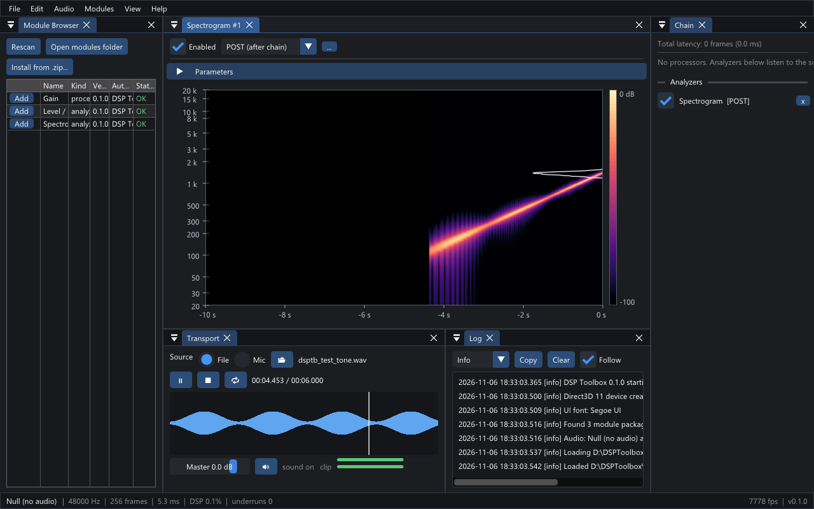
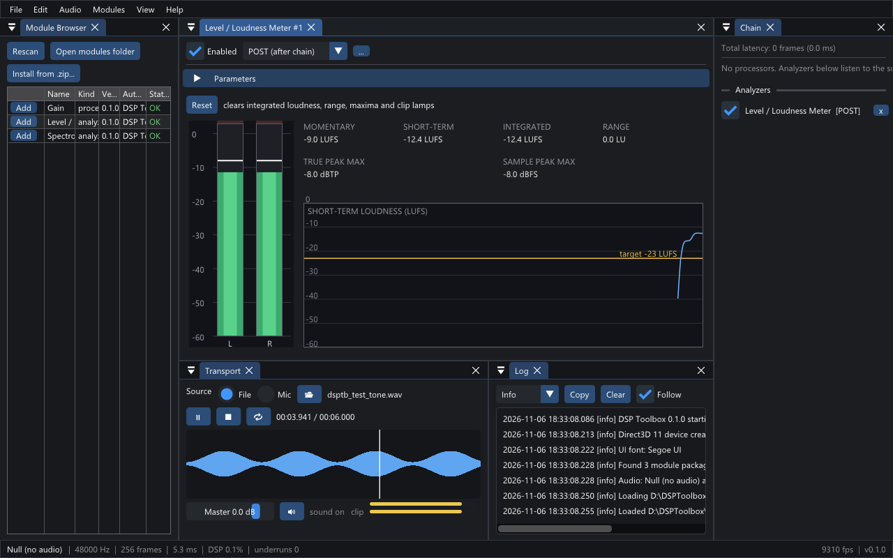
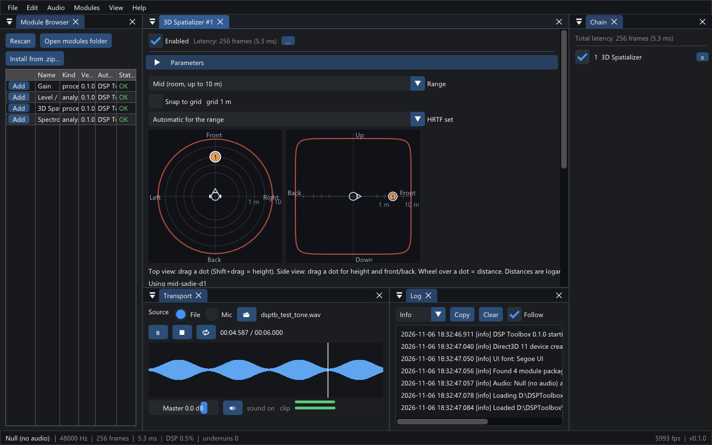

<p align="center">
  <picture>
    <source media="(prefers-color-scheme: dark)" srcset="assets/icon/icon-on-dark.png">
    
  </picture>
</p>

# DSP Toolbox

A modular, real-time audio workbench for Windows. Load an audio file or use your microphone, then add modules that each do one job: show a live spectrogram, measure loudness, or move a sound around your head in 3D. You can install modules, remove them or write your own.

| Spectrogram | Level / Loudness Meter |
|---|---|
|  |  |

## Download

1. Download `DSPToolbox-<version>-win64.zip` from the [latest release](https://github.com/inboxes/dsp-toolbox/releases/latest).
2. Unzip it anywhere and run `DSPToolbox.exe`. Nothing else needs installing.

You need Windows 10 22H2 or 11 (64-bit).

**Windows may warn you the first time.** The app isn't code-signed, so SmartScreen can say "Windows protected your PC". Choose **More info**, then **Run anyway**. To check your download first, compare its hash with `SHA256SUMS-<version>.txt` from the same release:

```powershell
Get-FileHash DSPToolbox-<version>-win64.zip -Algorithm SHA256
```

## Quick start

1. Choose **File > Open Audio File** and pick a WAV, FLAC or MP3 file.
2. In the **Module Browser**, press **Add** next to **Spectrogram**.
3. Press play in the **Transport** panel.

New to the app? The [wiki](https://github.com/inboxes/dsp-toolbox/wiki) walks you through it step by step, with guides for each module, audio setup and troubleshooting.

## What's included

- **Sources:** an audio file with loop and seek, or your microphone.
- **Audio:** WASAPI shared and exclusive modes, and ASIO® drivers.
- **Spectrogram:** a live scrolling view with linear, log and mel axes.
- **Level / Loudness Meter:** peak, RMS, true peak and EBU R128 loudness.
- **Gain:** a simple reference module.
- **Sessions:** save and reopen your setup, export processed audio to WAV, and record the input or output.
- **Command-line tools:** `dsptb-cli` generates test signals, analyzes files, renders sessions offline and validates modules. `dsptb-sofa` prepares HRTF files.

**Limits of this version:** Windows only, stereo only, and no VST3 or CLAP plugin hosting.


## Add-on modules

Larger modules are separate downloads, so the app stays small. To add one, download its zip from the [Releases page](https://github.com/inboxes/dsp-toolbox/releases) and choose **Modules > Install from .zip...** in the app.

### 3D Spatializer

Renders up to 8 sources for headphones with Steam Audio, as static sounds, orbits or keyframed paths. It has Near, Mid and Far ranges and selectable HRTF sets, and you can add your own. Download `org.dsptb.spatializer-<version>.zip` ([guide](https://github.com/inboxes/dsp-toolbox/wiki/3D-Spatializer)).



## Write your own module

Modules are DLLs built against a small C interface with a C++ SDK. You don't need the app's source code:

1. Download `dsptb-sdk-<version>.zip` from the Releases page.
2. Run `tools/new-module.ps1` from the SDK to create a project.
3. Build it, validate it with `dsptb-cli validate`, and zip the package folder.

See [Writing a Module](https://github.com/inboxes/dsp-toolbox/wiki/Writing-a-Module) and the [SDK reference](docs/MODULE_SDK.md).

Modules run as native code with your user's permissions, so only install ones you trust.

## Build from source

See [Building from Source](https://github.com/inboxes/dsp-toolbox/wiki/Building-from-Source). In short, with Visual Studio 2022, CMake, Ninja and vcpkg installed:

```powershell
./tools/check-toolchain.ps1
. ./tools/dev-env.ps1
cmake --preset windows-release
cmake --build --preset windows-release
ctest --preset windows-release
```

## Contributing

See [CONTRIBUTING.md](CONTRIBUTING.md). Please report security problems as described in [SECURITY.md](SECURITY.md).

## Licence

DSP Toolbox is licensed under the GNU General Public License, version 3 only ([LICENSE](LICENSE)). Modules that use only the public SDK may use other licences under the conditions in [MODULE-EXCEPTION.md](MODULE-EXCEPTION.md). We encourage open-source modules.

Each release lists its third-party software and data in `THIRD_PARTY_NOTICES.md`. The 3D Spatializer zip carries its own notices for [Steam Audio](https://valvesoftware.github.io/steam-audio/) by Valve (Apache-2.0), KEMAR near-field HRTF data (CC BY 4.0) and SADIE II HRTF data (Apache-2.0).

ASIO is a registered trademark of Steinberg Media Technologies GmbH.
